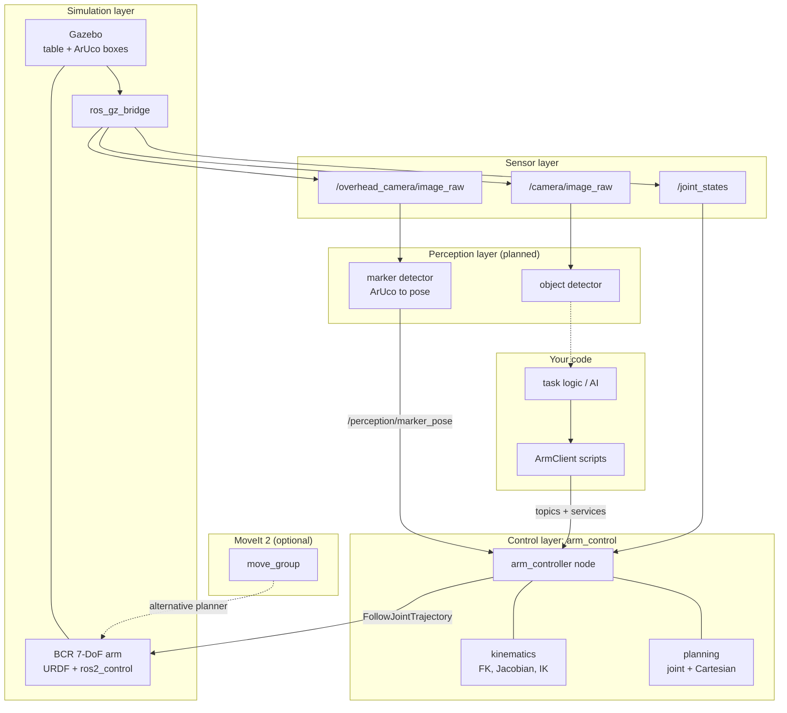

# ROBOTIC_ARM_

**An open-source robotic arm platform for learning perception, planning and control, with a simulation-first pick-and-place workflow.**

ROBOTIC_ARM_ is a ROS 2 workspace for a 7-DoF arm working on a table. It can move in joint space or in Cartesian (TCP) space, plan its own trajectories, and react to marker poses from a perception node. It is built as a **learning platform**: each layer (kinematics, planning, control, perception, simulation) is a separate piece you can read, replace or extend to test your own algorithms and concepts. It is built **simulation-first**, so anyone can develop and test ideas without owning hardware.

> **Safety notice:** ROBOTIC_ARM_ is a research and education project. Test in simulation first. Before using real hardware, add joint limits, speed limits and an emergency stop, and always supervise the arm.

<!-- Replace with your own media once ready -->
> **Demo videos:** _coming soon_
>
> | Arm in Gazebo | Joint-space motion | TCP waypoint motion | Marker pick-and-place |
> |---|---|---|---|
> | _video_ | _video_ | _video_ | _video_ |

---

## Table of contents

1. [Why this project exists](#why-this-project-exists)
2. [Project goals](#project-goals)
3. [What works today](#what-works-today)
4. [Architecture](#architecture)
5. [Repository structure](#repository-structure)
6. [Requirements](#requirements)
7. [Installation](#installation)
8. [Quick start](#quick-start)
9. [Launch options](#launch-options)
10. [Topics, services and sensors](#topics-services-and-sensors)
11. [Package reference](#package-reference)
12. [Controller configuration](#controller-configuration)
13. [Writing your own perception and AI nodes](#writing-your-own-perception-and-ai-nodes)
14. [Verifying your setup](#verifying-your-setup)
15. [Roadmap](#roadmap)
16. [Troubleshooting](#troubleshooting)
17. [Contributing](#contributing)
18. [License](#license)

---

## Why this project exists

Robot arms are hard to learn on. Industrial arms are expensive and closed, and most open examples hide the interesting parts inside large frameworks. ROBOTIC_ARM_ keeps the core ideas small and readable: the kinematics and trajectory code is plain Python with numpy, the controller is one node with a clear interface, and the simulation runs on a laptop. Students, hobbyists and researchers can use it to learn manipulation and to benchmark their own ideas.

## Project goals

- A clear, hackable **arm controller** with joint and Cartesian modes
- **Perception-driven manipulation**: detect an object, then move to it
- **Pick and place** and other multi-step tasks, selected as needed
- A modular design where kinematics, planning, perception and AI can each be swapped out
- A **simulation-first** workflow that can later move to real hardware
- A friendly base for experimenting with other algorithms and concepts

---

## What works today

| Component | Status |
|---|---|
| 7-DoF BCR arm model (URDF, meshes, ros2_control) | Working |
| Gazebo world: table, three ArUco-marked boxes, overhead camera | Working |
| Wrist depth camera on the arm (description) | Implemented |
| Joint-space and TCP-waypoint controller, switched by service | Working |
| Numpy kinematics (FK, Jacobian, damped least-squares IK) | Working |
| Eased joint and straight-line Cartesian trajectories with speed limits | Working |
| `goto_marker` service driven by `/perception/marker_pose` | Implemented |
| `ArmClient` Python helper and demo script | Working |
| MoveIt 2 configuration | Included |
| Isaac Sim USD description and launch file | Included, untested here |
| Perception node that publishes marker poses | **Planned: contributions welcome** |
| Gripper and full pick-and-place sequence | **Planned** |
| AI object detection and task selection | **Planned** |
| Real hardware | Planned |

The simulation, kinematics, planning and control foundation is in place. Perception, grasping and AI are where most of the manipulation features will be built, and they are ready for contributors.

---

## Architecture

The system is organised in layers. Each layer is its own ROS 2 package.



### How the layers fit together

| Layer | Packages | Purpose |
|---|---|---|
| **Simulation** | `arm_simulation`, `bcr_arm_gazebo`, `bcr_arm_description` | Arm model, Gazebo worlds, camera bridges, `ros2_control` controllers |
| **Control** | `arm_control` | Joint and TCP modes, kinematics, trajectory generation, marker approach |
| **Planning (optional)** | `bcr_arm_moveit_config` | MoveIt 2 setup to compare against the built-in planner |
| **Perception** | _planned_ | Turn camera images into `/perception/marker_pose` |
| **AI** | _planned_ | Object detection and task selection |

### Modes

The controller moves the arm in two **mutually exclusive** spaces and is switched by service:

| Mode | You send | The controller does |
|---|---|---|
| `joint` | Target joint angles | Plans an eased joint-space move |
| `tcp` | Cartesian waypoints | Solves IK along straight lines and follows them |

A command meant for the other mode is ignored and reported on `/arm_control/status`.

### Frames (TF)

```
world (= arm base) ─▶ base_link ─▶ link chain (joint1 … joint7) ─▶ flange ─▶ TCP
                  │                                                   └─▶ wrist camera
                  └─▶ overhead_camera_optical_frame (static)
```

The TCP is the flange frame plus a configurable offset (see [Controller configuration](#controller-configuration)). The overhead camera looks straight down at the table from 1.2 m above the table top.

---

## Repository structure

This repository contains ROS 2 packages at its root. Clone it into the `src/` folder of a colcon workspace (see [Installation](#installation)).

```
ROBOTIC_ARM_/
├── arm_control/                  # Controller, kinematics, planning, client
│   ├── arm_control/
│   │   ├── arm_controller.py         # Main node: modes, topics, services
│   │   ├── kinematics.py             # numpy FK / Jacobian / IK (no ROS imports)
│   │   ├── planning.py               # Joint and Cartesian trajectories (no ROS imports)
│   │   ├── client.py                 # ArmClient helper for your own scripts
│   │   └── example_client.py         # Demo: joint move, TCP path, mode checks
│   ├── config/arm_controller.yaml    # Speeds, home pose, TCP offset, marker settings
│   ├── launch/arm_controller.launch.py
│   └── README.md                     # Controller interface summary
│
├── arm_simulation/               # Pick-and-place table scene
│   ├── launch/
│   │   ├── arm_table.launch.py       # Gazebo + arm + bridges + controllers
│   │   └── arm_table_rviz.launch.py  # Same, plus RViz
│   ├── worlds/pick_place_table.world
│   ├── models/                       # table, aruco_box_red / green / blue
│   └── config/arm_table.rviz
│
├── bcr_arm_description/          # Arm model (Black Coffee Robotics, Apache-2.0)
│   ├── urdf/                         # xacro, ros2_control, depth camera, USD
│   ├── meshes/                       # .dae / .stl meshes
│   ├── launch/ and rviz/
│   └── LICENSE
│
├── bcr_arm_gazebo/               # Gazebo launch files, worlds and object models
│   ├── launch/                       # bcr_arm.gazebo / bringup.gazebo launch files
│   ├── worlds/                       # empty.world, house.world
│   ├── models/                       # coke_can, cardboard_box, mustard, ...
│   └── scripts/                      # control_arm_cli.py, test_arm_movement.py
│
└── bcr_arm_moveit_config/        # MoveIt 2 configuration
    ├── config/                       # SRDF, joint limits, controllers, kinematics
    └── launch/                       # demo, move_group, Gazebo and Isaac launches
```

---

## Requirements

| Component | Version |
|---|---|
| OS | Ubuntu <22.04 or 24.04> |
| ROS 2 | <Humble or Jazzy> |
| Simulator | Gazebo (`ros_gz_sim`, `ros_gz_bridge`) |
| Python | System Python 3 with `numpy` |

> Replace the placeholders with the versions you developed on. Use one consistent ROS 2 and Gazebo pairing.

A machine with a dedicated GPU is recommended. If Gazebo runs slowly, launch without the wrist camera (`use_camera:=false`).

---

## Installation

### 1. Install ROS 2

Follow the [official instructions](https://docs.ros.org/) for your distribution, then source it in your shell:

```bash
echo "source /opt/ros/<distro>/setup.bash" >> ~/.bashrc
source ~/.bashrc
```

### 2. Install dependencies

Replace `<distro>` with your ROS 2 distribution (for example `humble` or `jazzy`):

```bash
sudo apt update
sudo apt install -y \
  ros-<distro>-desktop \
  ros-<distro>-ros-gz \
  ros-<distro>-ros2-control \
  ros-<distro>-ros2-controllers \
  ros-<distro>-gz-ros2-control \
  ros-<distro>-xacro \
  ros-<distro>-robot-state-publisher \
  ros-<distro>-moveit \
  ros-<distro>-tf2-ros \
  ros-<distro>-rqt-image-view \
  python3-numpy \
  python3-colcon-common-extensions \
  python3-rosdep
```

### 3. Clone into a workspace

```bash
mkdir -p ~/arm_ws/src
cd ~/arm_ws/src
git clone https://github.com/vedant710/ROBOTIC_ARM_.git
cd ~/arm_ws
```

### 4. Resolve remaining dependencies

```bash
sudo rosdep init        # skip if already done
rosdep update
rosdep install --from-paths src --ignore-src -r -y
```

### 5. Build

```bash
cd ~/arm_ws
colcon build --symlink-install
source install/setup.bash
```

Add the workspace to your shell so you do not have to source it every time:

```bash
echo "source ~/arm_ws/install/setup.bash" >> ~/.bashrc
```

---

## Quick start

Make sure the workspace is sourced in every new terminal.

**1. Start the simulation** (Gazebo, arm, table, ArUco boxes, controllers):

```bash
ros2 launch arm_simulation arm_table.launch.py
```

**Or with RViz** (arm model, TF and the overhead camera feed):

```bash
ros2 launch arm_simulation arm_table_rviz.launch.py
```

**2. Start the arm controller** (second terminal):

```bash
ros2 launch arm_control arm_controller.launch.py
```

**3. Run the demo** (third terminal). It does a joint move, switches to TCP mode, moves over the boxes, and shows that wrong-mode commands are ignored:

```bash
ros2 run arm_control example_client
```

**Use it from your own script:**

```python
from arm_control.client import ArmClient

arm = ArmClient()
arm.set_mode("joint");  arm.go_home()
arm.set_mode("tcp");    arm.move_tcp([0.5, -0.1, 0.18])
```

**Switch modes and move from the command line:**

```bash
ros2 service call /arm_control/set_tcp_mode std_srvs/srv/Trigger
ros2 service call /arm_control/get_mode     std_srvs/srv/Trigger
ros2 service call /arm_control/stop         std_srvs/srv/Trigger
```

**Start in TCP mode:**

```bash
ros2 launch arm_control arm_controller.launch.py initial_mode:=tcp
```

**MoveIt 2** (optional, as an alternative planner):

```bash
ros2 launch bcr_arm_moveit_config bcr_arm_moveit_gazebo.launch.py
```

---

## Launch options

### `arm_simulation arm_table.launch.py`

| Argument | Default | Description |
|---|---|---|
| `robot_name` | `bcr_arm` | Name of the spawned model |
| `use_camera` | `true` | Bridge the wrist camera topics |
| `use_sim_time` | `true` | Use the Gazebo clock |
| `world_path` | `pick_place_table.world` | World file |
| `ros2_controllers_path` | MoveIt config `ros2_controllers.yaml` | Controller configuration |
| `x`, `y`, `z`, `yaw` | `0, 0, 0.70, 0` | Arm base pose. The table top is at z = 0.70 m. |

### `arm_simulation arm_table_rviz.launch.py`

| Argument | Default | Description |
|---|---|---|
| `use_rviz` | `true` | Open RViz |
| `use_sim_time` | `true` | Use the Gazebo clock |
| `rviz_config` | `config/arm_table.rviz` | RViz configuration |

### `arm_control arm_controller.launch.py`

| Argument | Default | Description |
|---|---|---|
| `use_sim_time` | `true` | Use the Gazebo clock |
| `initial_mode` | `joint` | `joint` or `tcp` |

### `bcr_arm_gazebo bringup.gazebo.launch.py`

| Argument | Default | Description |
|---|---|---|
| `use_camera` | `true` | Include the depth camera |
| `use_rviz` | `true` | Open RViz |
| `world_file` | package world | Gazebo world |
| `x`, `y`, `z`, `roll`, `pitch`, `yaw` | `0` | Initial pose |
| `load_controllers` | `true` | Spawn the controllers |

---

## Topics, services and sensors

### Sensors

| Sensor | Topic | Type | Notes |
|---|---|---|---|
| Overhead camera | `/overhead_camera/image_raw` | `sensor_msgs/Image` | Looks straight down at the table |
| Overhead camera info | `/overhead_camera/camera_info` | `sensor_msgs/CameraInfo` | |
| Wrist camera | `/camera/image_raw` | `sensor_msgs/Image` | Mounted on the arm. Enabled with `use_camera:=true`. |
| Wrist camera info | `/camera/camera_info` | `sensor_msgs/CameraInfo` | The camera is defined as 640×480 at 20 Hz, 10 m max range |
| Joint states | `/joint_states` | `sensor_msgs/JointState` | 7 joints: `joint1` … `joint7` |
| Clock | `/clock` | `rosgraph_msgs/Clock` | Simulation time |

### Controller inputs (`arm_control`)

| Topic | Type | Mode | Meaning |
|---|---|---|---|
| `/arm_control/joint_cmd` | `sensor_msgs/JointState` | joint | Target joints: 7 positions, or names plus positions for a subset |
| `/arm_control/tcp_waypoint` | `geometry_msgs/PoseStamped` | tcp | One waypoint, appended to the queue |
| `/arm_control/tcp_waypoints` | `geometry_msgs/PoseArray` | tcp | Several waypoints, appended in order |
| `/perception/marker_pose` | `geometry_msgs/PoseStamped` | any (stored) | Latest marker pose, used by `goto_marker` |

### Controller outputs

| Topic | Type | Meaning |
|---|---|---|
| `/arm_control/mode` | `std_msgs/String` (latched) | Current mode |
| `/arm_control/status` | `std_msgs/String` (JSON) | Progress, errors and ignored commands |
| `/arm_control/current_tcp_pose` | `geometry_msgs/PoseStamped` | Current TCP pose |
| `/joint_trajectory_controller/follow_joint_trajectory` | `control_msgs/FollowJointTrajectory` (action) | Trajectories sent to the arm |

### Services (`std_srvs/Trigger`)

| Service | Available in | Description |
|---|---|---|
| `/arm_control/set_joint_mode` | any | Switch to joint mode |
| `/arm_control/set_tcp_mode` | any | Switch to TCP mode |
| `/arm_control/get_mode` | any | Report the current mode |
| `/arm_control/stop` | any | Stop the current motion |
| `/arm_control/go_home` | joint | Move to the configured home pose |
| `/arm_control/goto_marker` | tcp | Move above the latest marker pose |

`goto_marker` refuses marker poses older than `marker_timeout` (2 s by default).

---

## Package reference

### `arm_control`
One node, `arm_controller`, with two exclusive motion spaces. It reads the URDF from `/robot_description`, builds a kinematic chain, and sends `FollowJointTrajectory` goals. Switching modes cancels any running motion by default.

| Module | Purpose |
|---|---|
| `kinematics.py` | Forward kinematics, Jacobian and damped-least-squares IK for a serial arm described by a URDF. Numpy only, no ROS imports, so it can be unit-tested and studied on its own. |
| `planning.py` | Joint-space and straight-line Cartesian trajectories with a cosine ease in and out. Durations are stretched so no joint exceeds the configured fraction of its URDF velocity limit. |
| `client.py` | `ArmClient`: switch modes and send moves from plain Python scripts. |
| `example_client.py` | End-to-end demo of both modes. |

### `arm_simulation`
A pick-and-place scene: a table, three boxes with ArUco textures (red = marker 0, green = marker 1, blue = marker 2) and an overhead camera. It spawns the arm on the table, bridges the camera topics and starts the controllers in order (`joint_state_broadcaster`, then `joint_trajectory_controller`).

### `bcr_arm_description`
The arm model from Black Coffee Robotics: URDF/xacro, meshes, RViz configs, ros2_control tags, a depth camera description and Isaac Sim USD files. Licensed under Apache-2.0.

### `bcr_arm_gazebo`
Gazebo launch files, two worlds (`empty`, `house`), a set of object models (coke can, cardboard box, mustard bottle, cheez-it box, red cylinder) and two CLI scripts for sending joint goals and testing movement.

### `bcr_arm_moveit_config`
MoveIt 2 configuration: SRDF, joint limits, controllers, kinematics, Pilz Cartesian limits and launch files for demo, Gazebo and Isaac Sim. Useful for comparing your own planner against MoveIt.

---

## Controller configuration

All tunable parameters live in `arm_control/config/arm_controller.yaml`:

| Parameter | Default | Description |
|---|---|---|
| `base_frame` / `tip_link` | `base_link` / `flange` | Kinematic chain ends |
| `tcp_offset` | `[0, 0, 0.105]` | TCP position in the flange frame (m). **Change this when you add a gripper.** |
| `initial_mode` | `joint` | `joint` or `tcp` |
| `cancel_on_mode_switch` | `true` | Stop any running motion when switching modes |
| `joint_speed_scale` | `0.3` | Fraction of the URDF joint velocity limits |
| `tcp_linear_speed` | `0.10` m/s | Cartesian speed |
| `tcp_angular_speed` | `0.5` rad/s | Cartesian rotation speed |
| `cartesian_step` | `0.01` m | IK resolution along straight lines |
| `angular_step` | `0.05` rad | IK resolution for rotation |
| `home_joints` | tool-down pose | Pose used by `go_home` (over the table centre at x 0.35, y 0, z 0.30) |
| `marker_pose_topic` | `/perception/marker_pose` | Where marker poses arrive |
| `marker_timeout` | `2.0` s | `goto_marker` refuses older poses |
| `marker_approach_offset` | `[0, 0, 0.12]` | Added to the marker position, in the base frame |
| `marker_approach_quat` | `[1, 0, 0, 0]` | Approach orientation (x y z w). This one points the tool down. |

Start slow: keep `joint_speed_scale` and `tcp_linear_speed` low until you have checked a new motion in simulation.

---

## Writing your own perception and AI nodes

The controller only needs one thing from perception: a `geometry_msgs/PoseStamped` on `/perception/marker_pose`, expressed in the arm base frame. That makes it easy to plug in your own detector.

Typical workflow, using a marker detector as an example:

1. Create a node that subscribes to `/overhead_camera/image_raw` and `/overhead_camera/camera_info`.
2. Detect the ArUco markers (OpenCV `aruco` works well) and estimate each pose.
3. Transform the pose into the arm base frame using the static overhead camera transform, and publish it on `/perception/marker_pose`.
4. Switch to TCP mode and call `/arm_control/goto_marker`.

```bash
ros2 service call /arm_control/set_tcp_mode std_srvs/srv/Trigger
ros2 service call /arm_control/goto_marker  std_srvs/srv/Trigger
```

For an AI or task layer, call `ArmClient` from your own node: choose a target, move above it, descend, grasp, lift and place.

To add a **new node**, create the Python file, register it under `entry_points → console_scripts` in the package's `setup.py`, and add it to a launch file.

Tips:

- Always check the pose frame before sending it. A wrong frame is the most common cause of surprising motion.
- Keep a safety margin: the default `marker_approach_offset` stops 12 cm above the marker.
- Test every new behaviour in simulation first, at low speed.

---

## Verifying your setup

Run these in order after the first build. Source the workspace in each terminal.

```bash
# Terminal 1
ros2 launch arm_simulation arm_table.launch.py
```

```bash
# Terminal 2
ros2 control list_controllers          # joint_state_broadcaster and joint_trajectory_controller: active
ros2 topic hz /joint_states            # joint states arriving
ros2 topic list | grep camera          # camera topics present
ros2 run rqt_image_view rqt_image_view # look at /overhead_camera/image_raw
```

Then start the controller and check it:

```bash
ros2 launch arm_control arm_controller.launch.py
ros2 service call /arm_control/get_mode std_srvs/srv/Trigger
ros2 topic echo /arm_control/current_tcp_pose --once
ros2 topic echo /arm_control/status
```

Finally run the demo:

```bash
ros2 run arm_control example_client
```

---

## Roadmap

Planned work, roughly in order. Items are **not implemented yet**. Pick one and open an issue to say you are working on it.

**Near term**
- [ ] Marker detection node that publishes `/perception/marker_pose` from the overhead camera
- [ ] Gripper model, controller and TCP offset update
- [ ] Full pick-and-place sequence (approach, descend, grasp, lift, place)
- [ ] Unit tests for `kinematics.py` and `planning.py`
- [ ] Clean packaging (descriptions, licenses and maintainer fields in every `package.xml`)

**Manipulation and AI**
- [ ] Object detection (YOLO / ONNX) on the wrist and overhead cameras
- [ ] Grasp pose estimation from depth
- [ ] Multi-object tasks: sorting by colour, stacking
- [ ] Natural-language task commands
- [ ] Collision-aware planning and a comparison with MoveIt

**Platform**
- [ ] Safety layer: joint and workspace limits, emergency stop
- [ ] Continuous integration (build and launch smoke test)
- [ ] Real-hardware bring-up guide and bill of materials
- [ ] More example tasks for learners

Have an idea or a concept you want to learn with this arm? Please open an issue.

---

## Troubleshooting

**The arm does not move.** Check `ros2 control list_controllers`: both controllers must be `active`. Then check that the arm controller is running and in the mode that matches your command (`/arm_control/get_mode`).

**My command is ignored.** A command for the other mode is ignored on purpose. Read `/arm_control/status`, switch modes, and send it again.

**`goto_marker` fails.** It works only in TCP mode and only with a marker pose newer than `marker_timeout`. Make sure `/perception/marker_pose` is publishing.

**Camera topics are missing.** Launch with `use_camera:=true`. The bridge expects the sensor to publish `camera/image_raw`. If `gz topic -l` shows other names, edit the bridge arguments in `arm_simulation/launch/arm_table.launch.py`.

**Gazebo cannot find the table or ArUco models.** The launch file appends the model folders to `GZ_SIM_RESOURCE_PATH`. Rebuild and source the workspace, then launch again.

**The arm is slow or looks stuck.** Speeds are limited on purpose (`joint_speed_scale: 0.3`, `tcp_linear_speed: 0.10`). Raise them in `arm_controller.yaml` once the motion is verified.

**IK fails for a pose.** The target may be out of reach or outside joint limits. Try a pose closer to the home pose, or a different approach orientation.

**Gazebo is slow.** Use `use_camera:=false`, close RViz, or lower the camera resolution in the description.

---

## Contributing

Contributions of every size are welcome: code, documentation, testing and ideas. Because this is a learning platform, clear and readable code is worth more than clever code.

**Good places to start:**

| Area | Where | Difficulty |
|---|---|---|
| Unit tests for kinematics and planning | `arm_control/arm_control/` | Beginner |
| Fill in package descriptions and licenses | each `package.xml` | Beginner |
| More example scripts with `ArmClient` | `arm_control/arm_control/example_client.py` | Beginner |
| Marker detector node | new `perception` package | Intermediate |
| Gripper and pick-and-place sequence | `arm_control`, `bcr_arm_description` | Intermediate |
| Object detection with YOLO / ONNX | new `ai` package | Intermediate |
| Collision-aware planning | `arm_control/planning.py` | Advanced |

**How to contribute:**

1. Fork the repository and create a branch: `git checkout -b feature/my-feature`
2. Build and test locally (see [Verifying your setup](#verifying-your-setup)).
3. Keep Python code PEP 8 compliant and add a docstring to every new module.
4. Open a pull request describing what you changed and how you tested it.

Bug reports are most useful with your ROS distro, Gazebo version, the launch command you ran and the terminal output.

Please be respectful and constructive.

---

## License

Released under the **Apache License 2.0**. See [LICENSE](LICENSE).

The `bcr_arm_*` packages were created by [Black Coffee Robotics](https://github.com/blackcoffeerobotics) and are also licensed under Apache-2.0. Their original license files are kept in their package folders.

## Author

Vedant Kulkarni ([@vedant710](https://github.com/vedant710))

## Acknowledgements

[Black Coffee Robotics](https://github.com/blackcoffeerobotics) for the BCR arm packages, [ROS 2](https://docs.ros.org/), [Gazebo](https://gazebosim.org/), [ros2_control](https://control.ros.org/) and [MoveIt 2](https://moveit.ai/).
